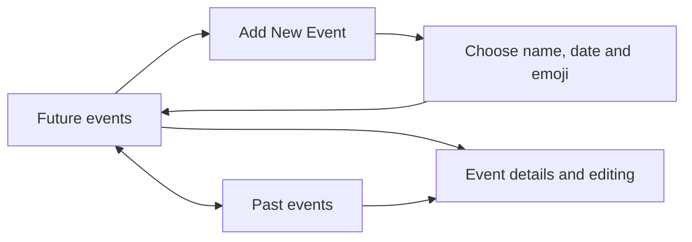

# Forward

Forward is an iOS app for keeping track of events you are looking forward to.
Add an event with an emoji and date, watch the countdown, and revisit past events.

The app's user-facing name is **Forward**, matching the Xcode project, app target,
and main scheme. The GitHub repository URL and legacy local-store name retain
FutureJoy for compatibility.

## Features

- Create events for today or a future date, with a preset or custom emoji,
  optional location, and notes.
- Browse **Future** events in date order, with the nearest event first, or switch
  to **Past** to see archived events with the most recent first.
- Open an event for a detailed countdown and edit its title, emoji, date,
  location, or notes. Rescheduling an archived event to today or later returns
  it to Future.
- Delete one event or select several and confirm a bulk deletion.
- Keep events across launches with SwiftData. Normal mode attempts CloudKit;
  simulator sample mode uses isolated local stores.

## App walkthrough



Start in **Future**, tap **+ Add** in the header, and save an event to see its countdown
card. Add stays available while scrolling in both Future and Past, including
selection mode. An inline **Add New Event** button also appears when Future has
no events, even if Past contains events; it disappears after the first creation
and returns after the last Future event is removed. Past retains its distinct
empty-state message. Both Add controls open the same creation form.
Tap **Forward** to return the current list to the top. Use **Select** on the left
for bulk deletion; selection mode shows **Cancel**, **Trash**, and **Add**.
Opening, cancelling, or saving creation preserves the active tab and selections.
Events created from Past appear in Future when you switch back to it.
Tap a card to open its details and use the edit control to make changes.
Switch to **Past** to review archived events. Events before today are archived
when the list refreshes on startup or when returning to the home screen; today's
events stay in Future. Use the [Typical sample profile](#simulator-sample-data)
to explore both lists without entering your own events.

## Requirements

- A Mac with **Xcode 26.1.1**, the toolchain pinned by CI and used for local
  verification. Older Xcode versions are not verified.
- **iOS 26.1 or later** on the destination device; the project deployment target
  is iOS 26.1. CI uses the iOS 26.1 simulator runtime and an iPhone 17.
- Git to clone the repository. There are no third-party package dependencies to
  install.

In Xcode Settings, open **Components** and install the iOS 26.1 simulator runtime
if it is missing. Confirm the selected command-line toolchain and runtimes:

```sh
export DEVELOPER_DIR=/Applications/Xcode.app/Contents/Developer
xcodebuild -version
xcrun simctl list runtimes
```

If Xcode is installed elsewhere, adjust `DEVELOPER_DIR` to that installation's
`Contents/Developer` directory.

## Build and run locally

```sh
git clone https://github.com/hn374/FutureJoy.git
cd FutureJoy
open Forward.xcodeproj
```

1. Select the shared **Forward** scheme and an iOS 26.1 or later simulator.
2. Use the **Debug** build configuration (the scheme's Run default).
3. For fictional data, enable `--sample-data` under **Product → Scheme → Edit
   Scheme → Run → Arguments** as described [below](#simulator-sample-data).
   Leave it off to use normal persistence.
4. Choose **Product → Run** (`⌘R`). The home-screen heading is **Forward**.

Simulator builds use the default simulator signing and do not require Apple
credentials. Keep signing enabled: normal-mode CloudKit initialization needs the
app's entitlements, including for the app-hosted unit tests.

For a compile-only simulator check from the repository root (no simulator boot):

```sh
xcodebuild build -project Forward.xcodeproj -scheme Forward \
  -configuration Debug -destination 'generic/platform=iOS Simulator' \
  -derivedDataPath /tmp/ForwardDerivedData
```

### Schemes and device setup

| Scheme | Purpose and current status |
| --- | --- |
| **Forward** | Shared, supported app scheme. Use it for running, building, and testing. Includes `ForwardTests` and `ForwardUITests`. |
| **Forward Dev** | Additional target/scheme that may appear in Xcode. It currently excludes the app entry point, model, and views from target membership; use Forward for development. |

To run on a physical device, select your own development team under the Forward
target's **Signing & Capabilities** and configure signing for a bundle identifier
and iCloud container you control. The repository currently references
`Hoang.Forward` and `iCloud.Hoang.Forward`; the container in
`Forward/ForwardApp.swift` and the iCloud entitlement must agree if you change
it. Physical-device signing and CloudKit sync need separate verification with
your developer account. Sample mode is available only in Debug simulator builds.

## Project structure

```text
Forward.xcodeproj/        Project and shared Forward scheme
Forward/
  ForwardApp.swift        App entry point and normal persistence setup
  Models/                SwiftData Event model
  ViewModels/            Event lists, archiving, selection, and mutations
  Views/                 Home, event cards, creation, and detail/edit screens
  Development/           Simulator-only sample profiles and stores
  Utils/                 Emoji input and a local-to-CloudKit migration utility
  Assets.xcassets/       App icons and colors
ForwardTests/            Unit, persistence, behavior, and opt-in benchmark tests
ForwardUITests/          UI interaction and launch tests
.github/                 CI workflow and local CI test script
```

The app uses SwiftUI with a view model coordinating event queries and mutations
through SwiftData's `ModelContext`. `Forward/tech_design.md` is an older design
note; some of its feature, setup, and testing descriptions predate the current
implementation.

## Data storage

Normal startup first tries a SwiftData container backed by the private CloudKit
database `iCloud.Hoang.Forward`. If that container cannot initialize, it opens a
local-only store at `Documents/FutureJoy.store` inside the app sandbox. A
successful container initialization does not by itself verify cross-device sync.

The local fallback and CloudKit-backed store are separate configurations. A
migration utility exists in `Forward/Utils/DataMigration.swift`, but startup does
not call it; do not assume local fallback events are automatically imported if
CloudKit becomes available later.

Past events are archived records, not deleted records. Explicit deletion removes
the selected events after confirmation. Sample mode never imports normal data
and disables CloudKit; its separate store paths and reset behavior are documented
[below](#simulator-sample-data).

## Running tests

For every test run, including Xcode's Test action, use a **disposable simulator
signed out of personal iCloud**. Tests reset sample profiles and create or delete
events in the normal store; do not use a simulator containing data you want to
keep. Follow the simulator capacity guidance below before starting a run.

Use the shared **Forward** scheme. In Xcode, open the Test navigator to select
individual tests or choose **Product → Test** (`⌘U`) to run the scheme's full
inventory. This includes UI launch/performance tests and opt-in benchmarks that
are excluded from the CI gate. The [CI section](#continuous-integration) provides
the command for reproducing that smaller gate locally.

For functional unit tests from the terminal, choose a disposable simulator signed
out of personal iCloud, find its identifier with `xcrun simctl list devices
available`, and replace `<SIMULATOR_ID>`:

```sh
xcodebuild test -project Forward.xcodeproj -scheme Forward \
  -configuration Debug \
  -destination 'platform=iOS Simulator,id=<SIMULATOR_ID>' \
  -parallel-testing-enabled NO \
  -only-testing:ForwardTests \
  -skip-testing:ForwardTests/EventListBenchmarkTests
```

For UI tests, replace the last two options with `-only-testing:ForwardUITests`.
To run only the opt-in measurements, use
`-only-testing:ForwardTests/EventListBenchmarkTests` instead. Benchmarks provide
measurements for controlled comparisons, not a timing pass/fail budget.

On a shared Mac, inspect `xcrun simctl list devices` and coordinate with other
users or tasks before starting a simulator or test run. The commands here use one
explicit destination with parallel testing disabled. Do not run competing tests
on the same simulator or shut down another user's device to make room.

## Continuous integration

**iOS CI / Build and test** runs for pull requests targeting `main`, pushes to
`main`, and manual dispatches. It uses the standard `macos-15` hosted runner,
Xcode 26.1.1, and a fresh iPhone 17 simulator running iOS 26.1. The shared
**Forward** scheme builds the app and both test targets without user-local schemes.

The gate runs all `ForwardTests` except the opt-in `EventListBenchmarkTests`.
The focused UI tests are:

- `EventCreationEmojiUITests/testCreateEventWithCustomEmojiPersistsAndCanBeEdited`
- `SimulatorSampleDataUITests/testProfilesSwitchPersistAndResetIndependently`
- `SimulatorSampleDataUITests/testSampleEditsAndDeletionPersistUntilExplicitReset`
- `SimulatorSampleDataUITests/testSwitchingModesAndResetPreserveNormalEvents`
- `SimulatorSampleDataUITests/testArchivedEventRescheduledToFutureMovesListsAndPersists`
- `SimulatorSampleDataUITests/testArchivedEventRescheduledToTodayMovesListsAndPersists`

Additional local regression coverage includes `PersistentHeaderUITests` for persistent
creation, draft cancellation, selection, empty/Past states, and accessible touch
areas, plus `ListSwitchingUITests` for scroll reset and title scrolling.
Tap the Forward title to scroll the active list to its beginning with a brief
ease-in-out transition; Reduce Motion makes that reset immediate. The title
retains its accessible “Forward, scroll to top” label. Title regression tests
check both long lists return to their original top, repeated activation, and
empty/short list stability. For motion verification, use the Busy sample profile
in both tabs: tap the title from the middle and bottom, interrupt with a drag,
and tap again during the transition. Repeat with Settings → Accessibility →
Motion → Reduce Motion enabled. On a physical device, also use VoiceOver to
activate the title (VoiceOver is unavailable in Simulator).
Confirm the first event is fully visible, selection survives, and switching
tabs still resets to the destination's top.
Other UI cases and template UI launch/performance tests are outside this initial gate.
Simulator boot overlaps the build; the script waits for boot to finish before
starting tests. Tests run serially on one simulator. The script checks the results
to ensure that every selected UI test and the required functional unit inventory actually ran
and passed, and benchmarks did not run. Update that inventory in
`.github/scripts/ios-ci.sh` when intentionally renaming or removing unit tests.

No Apple credentials or repository secrets are required. Simulator signing stays
enabled for CloudKit initialization, but the runner has no personal iCloud account.
These checks do not verify cloud sync. The **forward-test-results** artifact
retains build logs and any test logs, screenshots in `.xcresult`, and result JSON
produced for seven days, including on failures. Logs and artifacts are public;
use fictional test data only. New PR commits cancel older runs for that PR; jobs
time out after 45 minutes.

To run the same build and test commands locally, from the repository root:

```sh
# Use Xcode 26.1.1 and a disposable simulator signed out of iCloud.
export DEVELOPER_DIR=/Applications/Xcode.app/Contents/Developer
export SIMULATOR_ID=$(xcrun simctl create "Forward CI Local" \
  com.apple.CoreSimulator.SimDeviceType.iPhone-17 \
  com.apple.CoreSimulator.SimRuntime.iOS-26-1)
export RUNNER_TEMP=$(mktemp -d)
xcrun simctl boot "$SIMULATOR_ID"
bash .github/scripts/ios-ci.sh
# After inspecting the results, remove only this disposable simulator.
xcrun simctl shutdown "$SIMULATOR_ID"
xcrun simctl delete "$SIMULATOR_ID"
```

Inspect the run in GitHub's Actions tab and download **forward-test-results** to
open `ForwardTests.xcresult` in Xcode. A missing toolchain/runtime fails during
simulator preparation; check the runner's installed software before updating the
pinned versions. Build failures are in `forward-build.log`; test failures are in
`forward-tests.log` and the result bundle when produced. For local clipboard UI
failures, avoid simultaneous simulator test runs with shared clipboard syncing.
The manual trigger appears after the workflow reaches the default branch.

## Simulator sample data

Use the **Forward** scheme with a **Debug** build on an iOS simulator. In Xcode,
open **Product → Scheme → Edit Scheme → Run → Arguments**, then add and enable:

```
--sample-data
```

Choose a dataset from the **Profile** menu above the app. The banner stays
available while viewing event details. Switching profiles saves changes already applied to the current dataset and
returns to a fresh home screen. Save an open editor before switching if you
want to keep its draft.

| Profile | Initial data |
| --- | --- |
| Empty | No events |
| Typical | Six varied events, including today, upcoming, and archived events |
| Busy | 300 events across dates and categories |
| Edge cases | Eight events with long text, composed emoji, optional fields, and shared dates |
| Archive-heavy | Twenty archived events and one upcoming event |

Sample mode uses separate local SwiftData stores with CloudKit disabled. It never
imports normal app data. Edits, deletions, and events you create stay with each
profile across switches and launches; fixture dates stay unchanged and age
naturally. Typical reuses the original sample store, preserving existing edits.

Typical is selected on each launch by default. To launch another profile directly,
add two argument entries in Xcode (the flag and its value):

```
--sample-profile
empty
```

Allowed values are `empty`, `typical`, `busy`, `edge-cases`, and `archive-heavy`.
An unknown or missing value shows a diagnostic instead of opening another store.
Profile selection alone does not activate sample mode; `--sample-data` is required.

Use **Reset profile** and confirm the named profile to replace only its events
with the original fixtures dated relative to today. Other profiles stay unchanged.
For automated runs, also enable:

```
--reset-sample-data
```

This resets only the launch-selected profile. Disable the reset argument after
that launch to preserve subsequent changes. The reset argument alone does nothing.

Remove `--sample-data` and relaunch to return to the normal app and its existing
data. Release builds and physical-device builds ignore all sample arguments and
have no profile controls. Stores live inside the simulator app's sandbox at:

- Typical: `Application Support/SimulatorSampleData/Fixtures-v1.store`
- Others: `Application Support/SimulatorSampleData/Fixtures-<profile>-v1.store`

Run the sample tests on a disposable simulator signed out of personal iCloud.
Unit tests are app-hosted, so the host can initialize normal persistence before
the tests run. Replace `<SIMULATOR_ID>` below with that simulator's identifier:

```sh
xcodebuild test -project Forward.xcodeproj -scheme Forward \
  -configuration Debug \
  -destination 'platform=iOS Simulator,id=<SIMULATOR_ID>' \
  -parallel-testing-enabled NO \
  -only-testing:ForwardTests/SampleDataLaunchModeTests \
  -only-testing:ForwardTests/SimulatorSampleStoreTests \
  -only-testing:ForwardUITests/SimulatorSampleDataUITests
```

Keep the simulator's default code signing enabled for normal-mode host startup;
CloudKit requires the app's entitlements even without a signed-in iCloud account.

## Contributing and reporting issues

Report bugs or propose changes through [GitHub Issues](https://github.com/hn374/FutureJoy/issues).
For a bug, include the Xcode and iOS versions, whether sample mode is enabled
(and which profile), steps to reproduce, and the expected and actual behavior.
Use fictional events in screenshots or logs and remove personal data and secrets.

For a contribution, keep the change focused, add or update tests for observable
behavior changes, and describe the change and verification in the pull request.
Run the relevant tests before requesting review; use the CI selection above to
reproduce the automated gate locally when needed. Required CI remains a merge
gate; local checks do not replace it. There is no
separate contribution guide or issue template in the repository at present.

## License

The repository does not currently include a `LICENSE` file. No open-source
license is declared here; adding one requires a decision by the repository owner.
